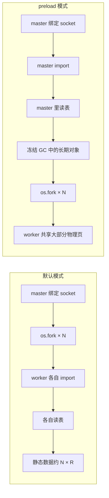

风控服务的一次请求要完成宽表关联、特征计算和模型推理。这些计算依赖固定的关联宽表、词表和分箱字典。为了避免每次请求都重新读盘或访问外部存储，服务会在启动时把它们一次性加载到内存。这些工作以 CPU 计算为主，请求之间相互独立，通常可以通过增加计算进程提高并发能力。问题在于，磁盘上几百 MB 的静态数据，加载成 DataFrame 等 Python 对象后可能膨胀到数 GiB，每个进程再各自加载一份。在测试环境中，2 个进程处理轻请求时已经占用 6.3 GiB，3 个进程处理重请求时占用 8.7 GiB；继续增加并发，内存会先于 CPU 达到上限。

这次采用的办法是让 Gunicorn 主进程（master）先加载只读大对象，再 `fork` 出计算进程（worker）。借助 Linux 的 Copy-on-Write（CoW），多个进程可以共享这些对象对应的物理页。

<!--more-->

---

## 一、目标与约束：在有限内存下提高并发能力

这次优化要解决的是并发能力不足：单个请求的计算速度可以接受，但服务器同时处理的请求数量有限。优化还要满足三个约束：计算结果不能变化，现有逻辑依赖整张表，单个计算器实例不能同时处理多个请求。

同步 worker 一次只能处理一个请求，因此并行度基本等于 worker 数。Gunicorn 的 `-w N` 会启动 N 个 worker，不包含 master。增加 worker 本应直接提高并行度，实际却先碰到了内存上限。

特征和模型依赖几张启动时加载的宽表，以及词表、分箱字典等静态数据。它们在磁盘上只有几百 MB，转成 DataFrame、索引和 Python 字符串对象后，单个进程可能占用 3～5 GiB。Gunicorn 默认先 `fork`，再由各 worker 分别导入应用，因此每个 worker 都会独立加载一份。

真正限制并发的是静态数据按进程重复加载。若加载后的静态数据为 R GiB，N 个 worker 仅这一项就接近 `N × R`，还没有计入临时 DataFrame、分词缓冲和模型工作区。

## 二、为什么线程、协程和改数据结构都不合适

计算器实例会保存单次请求的中间状态。同一进程同时处理两个请求，后一个请求可能覆盖前一个请求的数据。加锁可以保证正确性，但也会让请求重新串行。即使解决了状态问题，这类 CPU 密集型 Python 代码仍会受到 GIL 限制；协程适合隐藏 I/O 等待，而当前这个问题的主要瓶颈不在耗时。

因此，在不重写计算器的前提下，一个进程同一时刻只能处理一个请求，提高并行度仍要依靠多进程。

宽表也不能简单换成几个 dict。计算涉及整表关联、分组和全表统计，改变数据结构往往意味着重写计算逻辑。即使只更换容器，Python 字符串、索引和对象头的开销也依然存在。

| 方案 | 做什么 | 为什么先放下 |
|---|---|---|
| 直接加 worker | 增大 `-w` | 静态数据随 worker 数近似线性增长 |
| 加线程 | 设置 `--threads > 1` | 实例状态不安全，CPU 计算还受 GIL 影响 |
| 换协程 | 使用 asyncio 或 gevent worker | 主要耗时不在 I/O 等待 |
| 改数据结构 | 将 DataFrame 改成 dict 或裁列 | 会改动计算逻辑，收益也不确定 |
| 拆服务 | 按模块拆进程并按需加载 | 改造范围较大，不适合作为这次的最小变更 |
| preload + CoW | 先加载，再 `fork` | 不改公式，静态数据有机会跨进程共享 |

在不重写计算逻辑的前提下，并发仍要依靠多进程。需要改变的不是数据结构，而是静态数据在内存中的保存方式：逻辑上每个进程都能访问，物理上尽量只保留一份。

## 三、方案：在 `fork` 前加载只读数据

如果大表在 `fork` 前加载，并且请求不会修改它，那么增加 worker 时，新增的主要是各 worker 的私有工作内存，而不是整份大表。

Gunicorn 本来就通过 `fork` 创建 worker。`--preload` 改变的只是应用加载时机：

- 默认模式：master 先 `fork`，每个 worker 再导入应用并加载大表；
- preload 模式：master 先导入应用并加载大表，再 `fork` worker。

请求分发方式不变：master 仍负责监听 socket 和管理 worker，实际计算仍由 worker 完成。



配置可以写成：

```python
# gunicorn.conf.py
import gc

gc.disable()

preload_app = True
workers = 6


def when_ready(server):
    gc.collect()
    gc.freeze()


def post_fork(server, worker):
    gc.enable()
```

`gc.disable()` 要早于大对象加载，`gc.freeze()` 则放在应用加载完成、worker 创建之前。子进程只需重新启用 GC，不要调用 `gc.unfreeze()`，否则这些长期对象会重新进入后续扫描。

## 四、为什么这样能省内存

### 4.1 `fork` 之后不会立刻复制整个堆

子进程会继承父进程的地址空间。刚完成 `fork` 时，父子进程的虚拟地址映射到同一批物理页；只有某个进程写入页面时，内核才会复制该页。未被写入的页面可以继续共享，这就是 Copy-on-Write。

因此，大表必须在 `fork` 前加载。若 worker 创建后才导入应用，这些对象从一开始就是各进程独立分配的，CoW 无从发挥作用。`exec` 会替换进程映像，也不能保留这批对象。

CoW 按页工作，不是按对象工作。改一个字段不会立即复制整张表，但如果写入分散在大量页上，共享部分仍会逐渐变成私有页。

### 4.2 `gc.freeze()` 只能减少 GC 引起的写入

CPython 的循环 GC 会在扫描时修改对象的 GC 元数据，从而写脏原本可共享的内存页。`gc.freeze()` 会把当时受 GC 跟踪的对象移入永久代，后续回收不再扫描它们，可以减少这类与业务无关的 CoW。

但它不是内存只读开关，也不会关闭引用计数。读取由大量 Python 对象组成的数据结构时，引用计数变化仍可能写脏部分页面。它只能改善共享效果，不能保证所有页面始终只有一份，最终仍要以实测为准。

### 4.3 只读是前提

请求不能原地修改共享表。只要发生写入，相关页面就会成为当前 worker 的私有页；写入越分散，CoW 的收益越小。`fork` 后才懒加载的对象也无法共享。

还有两个容易忽略的问题：

- BLAS、分词器和推理运行时可能在 import 时创建线程池。多线程进程再 `fork` 存在死锁风险，应在 import 前限制线程数，并单独验证稳定性；
- import 阶段创建的数据库连接、网络连接和后台线程不适合直接继承。连接应延迟到 worker 中创建，或在 `post_fork` 中重建。

## 五、验证方案：结果一致、内存共享、请求隔离

服务能启动并不代表改造有效。计算结果要与改造前一致，静态数据要确实由多个进程共享，同一进程内连续处理多个请求时也不能发生状态污染。

理想情况下应运行三组：

- 基线组：关闭 preload，worker 数为 N；
- 同规模组：开启 preload，worker 数仍为 N，用来比较内存变化；
- 容量组：开启 preload，worker 数提高到 2N，用来确认省下的内存能否换成并发。

三组使用同一镜像和输入，除 preload 与 worker 数外保持配置一致，并在相同资源规格下运行。资源不足时，至少保留基线组和容量组，再结合进程级 PSS 和私有内存确认大表确实被共享。由于这两组同时改变了 preload 和 worker 数，不能只凭容器总内存归因。

### 5.1 正确性

正确性测试使用相同输入，比较改造前后的接口计算结果，不把耗时、日志和外部依赖状态混在一起。浮点数按允许误差比较，不直接使用 `==`。轻请求用于覆盖常见路径，重请求用于触发完整计算和较大的临时对象。若两边都因同一外部依赖失败，应归为环境问题，而不是 preload 缺陷。

### 5.2 共享效果

不要把各进程的 RSS 相加。共享页会同时出现在多个进程的 RSS 中，求和会重复计算。容器总占用看 cgroup 的 `memory.current` 或容器 working set；进程级数据可看 `/proc/<pid>/smaps_rollup` 中的 PSS、`Shared_Clean`、`Shared_Dirty`、`Private_Clean` 与 `Private_Dirty`。

启动后的空闲值也不能直接用于容量规划。要用重请求把工作内存推到高水位，再判断增长来自 worker 私有内存，还是静态表被大面积写脏。

### 5.3 请求隔离

将 worker 固定为 1，在同一进程中连续发送 A → B → A，中间不留等待时间。第一次和第三次 A 的结果必须一致，A 与 B 的差异则应符合输入差异。这可以检查计算器实例中的可变状态是否泄漏到下一个请求。

## 六、实测结果

测试机器无法同时容纳三组服务，因此只运行了基线组和容量组，并用进程级内存数据补充检查共享情况。测试环境为 Linux 容器，两组使用同一镜像。相同输入下，轻、重请求中能够正常计算的模块均无结果差异；A → B → A 中两次 A 的结果也完全一致。

内存结果如下：

| 场景 | 基线组 | 容量组 | 并发能力 | 内存成本 |
|---|---|---|---|---|
| 轻请求 | 2 worker，preload 关闭 | 4 worker，preload 开启 | 提高至原来的 2 倍 | 6.3 GiB → 3.5 GiB，节约 44% |
| 重请求 | 3 worker，preload 关闭 | 6 worker，preload 开启 | 提高至原来的 2 倍 | 8.7 GiB → 5.4 GiB，节约 38% |

两组使用相同的机器规格和请求数据。同步 worker 一次处理一个请求，因此同等资源下可同时处理的请求数提高至原来的 2 倍。与此同时，处理相同请求的内存成本并未增加：轻请求节约约 44%，重请求节约约 38%。

若按并发能力归一化，轻请求的单位并发内存成本从 3.15 GiB 降至 0.88 GiB，节约约 72%；重请求从 2.90 GiB 降至 0.90 GiB，节约约 69%。轻请求的延迟仍在同一量级。

重请求之后，容量组约有 3.2 GiB 共享静态数据，master 私有内存约 5 MiB。其余部分主要来自处理过重请求的 worker，每个 worker 的私有内存约为 100～700 MiB。此时每个进程的 RSS 依旧显示 3.x GiB，因为同一批共享页被重复计入各进程。

这些数据支持前面的假设：worker 数增加后，主要增长的是各 worker 的私有工作内存，而不是整份静态数据。容量不能再按 `N × 整体进程内存` 估算，而要拆成：

```text
单机内存 ≈ 一份共享静态数据
         + N × 单 worker 私有内存高水位
         + master 及其它固定开销
```

## 七、适用边界

这套方案只解决静态大对象按进程重复加载的问题：

- 表本身没有变小。磁盘文件加载后仍然占数 GiB，只是多数物理页不再按 worker 数复制；
- 请求期间新建的 DataFrame、分词缓冲和模型工作区属于 worker 私有内存，仍要按并发数计算；
- glibc 不一定及时把释放的内存归还操作系统，处理过重请求的 worker 可能长期停在高水位；
- 原地修改静态表会逐页破坏共享，fork 后懒加载的数据也无法共享；
- 方案依赖支持 CoW 的 `fork` 模型，不适用于 Windows，也不能直接照搬到使用 `spawn` 的进程模型；
- preload 会把 import 副作用带到 master，必须重新检查连接、线程和进程相关资源；
- 一次结果对比测试只能证明当下的正确性和共享效果，原生库与 `fork` 的偶发死锁、长期运行后的页面写脏仍需持续观察。

采用 preload + CoW 后，容量规划不能再用单个进程的 RSS 乘以进程数，而要分别计算共享静态数据和各进程的私有内存高水位。它不会让多进程只占一份内存，只是让其中最大的只读部分尽量共享；剩余的私有内存，仍然决定着单机可以承载多少并发进程。
