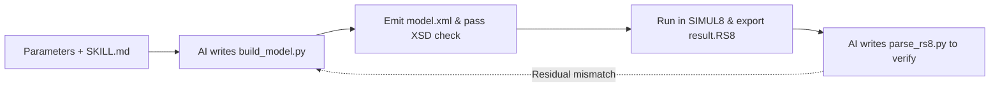
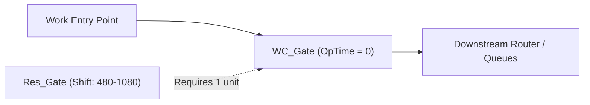

The previous post examined SIMUL8's XML structure and how to validate generated files against `simul8_valid.xsd` using `lxml`. Schema validation catches tag typos and structural errors so that the `.xml` file loads cleanly in the SIMUL8 desktop GUI. However, the gap between "the XML passes XSD validation and opens in the GUI" and "the model produces valid simulation results at runtime" remains wide.

The XSD only defines static syntax (for example, declaring that a tag contains an integer). It does not specify runtime semantics (such as which integer code routes expired queue items, or why parallel work centers report zero average working time in the output). This post documents the undocumented integer encodings, three runtime engine quirks, and the `.RS8` result verification loop, and packages them into a reusable `SKILL.md` specification so an AI coding agent can build and verify SIMUL8 models via Python scripts.

<!--more-->

---

## 1. Goal and Constraints: Schema Validity Does Not Imply Runtime Validity

The objective is to let an AI agent construct a multi-stage SIMUL8 discrete-event simulation model from operational parameters without manual GUI drag-and-drop, and verify that the simulated behavior matches the intended parameters. Three constraints shape this workflow:

1. **Closed-source desktop runtime**: SIMUL8 runs as a Windows desktop application. In cross-platform or headless environments, models must be compiled to `.xml` locally, executed in SIMUL8, and exported as `.RS8` result files.
2. **XSD validates structure, not semantics**: Many elements in `simul8_valid.xsd` are typed simply as `xs:integer` or `xs:string`. If an AI guesses the wrong enum value or omits one side of a two-way link, the file still passes XSD validation, but entities silently stall or vanish at runtime.
3. **Silent default outputs**: Unless specific KPI collection codes are pre-registered inside the XML `<ResultsSummary>` block, the exported `.RS8` report contains almost no metrics, leaving the AI with no feedback signal to verify the run.

Bridging this gap requires supplying the AI with SIMUL8's implicit enum mappings, topological workarounds for engine quirks, and an automated `.RS8` parser.

---

## 2. Why COM Automation and Direct XML Generation Fall Short

There are several ways an AI agent could interact with SIMUL8. Testing rules out the first three approaches:

| Approach | Mechanism | Why It Is Set Aside |
| :--- | :--- | :--- |
| **Windows COM API** | Connect to `SIMUL8.S8Simulation` via `win32com` to create objects | Tied to Windows; restricted or student licenses trigger modal warning dialogs on COM calls, and several shift and routing properties fail to write via COM |
| **Direct XML generation by LLM** | Prompt the LLM to output raw `.xml` text directly | A model with dozens of nodes exceeds 100 KB of XML; LLMs frequently drop symmetric `<InputList>` / `<OutputList>` references or miscalculate canvas coordinates |
| **Custom Python SDK wrapper** | Maintain a dedicated third-party Python library for the AI to import | Adds maintenance overhead; coding agents already know `xml.etree.ElementTree` and only need the domain rules to write generator functions on the fly |
| **Python generator + `.RS8` parser** | **Provide a `SKILL.md` spec so the AI writes a generator script and a verification script** | **Zero external dependencies; Python loops enforce symmetric links and grid coordinates, while `.RS8` parsing closes the verification loop** |

The resulting workflow operates as a closed loop:



---

## 3. Undocumented Integer Encodings and KPI Instrumentation

Without explicit constraints, an AI agent tends to guess SIMUL8's internal object names and integer codes from UI labels. The following three sets of encodings are absent from `simul8_valid.xsd` and need to be specified explicitly.

### 3.1 Object Types and `*Calc` Mirror Fields

The `Type` attribute on `<SimulationObject>` differs from the common names shown in the SIMUL8 ribbon:
- An entry point (Start Point) must be written as `Work Entry Point`.
- A processing activity (Activity) must be written as `Work Center`.
- A buffer or queue must be written as `Storage Area`.
- An exit sink (End Point) must be written as `Work Complete`.

When configuring probability distributions (such as `<InterArrivalTimeSampleData>` or `<OperationTimeSampleData>`), alongside `<DistribType>` (`1` = Fixed, `2` = Exponential, `3` = Normal) and `<DistParam1>`, the generator should also write the mirror tag `<DistParam1Calc>` with the same value. For a queue's minimum waiting delay, SIMUL8 reads `<Min_wait_timeCalc>` directly inside the `Storage Area` element. In addition, boolean flags inside `<DisplayData>` take `Yes` / `No` rather than `1` / `0`.

### 3.2 Routing Modes and Link Constants

Every `<Link>` element inside `<InputList>` and `<OutputList>` requires two fixed child tags: `<S8TheType>1000</S8TheType>` and `<S8ObjectType>1</S8ObjectType>`.

Outbound routing and inbound pulling on a `Work Center` are controlled by `<Routemode>` and `<InRoutemode>`:

| XML Tag | Integer Value | Meaning and Usage |
| :--- | :---: | :--- |
| `<Routemode>` | `1` | Default circulate routing (sends items to the first available downstream object) |
| `<Routemode>` | `3` | Percentage routing; each downstream `<Link>` specifies its branch share in `<Percent>` |
| `<InRoutemode>` | `4` | **Expired Only**: pulls only items that have exceeded the upstream queue's shelf-life (`<Expiretime>`) |

`<InRoutemode>4</InRoutemode>` is required when modeling queue abandonment, as covered in Section 4.3.

### 3.3 `<ResultsSummary>` Instrumentation and `.RS8` Parsing

The `.RS8` file exported after a simulation run is also an XML document, but it only records metrics that were pre-registered in the model's Results Summary. To make simulation outputs machine-readable, the generator script populates `<ResultItem>` nodes under `<SimulationParameters><ResultsSummary>`:

```python
def add_result_item(rs_elem, obj_id: int, code1: int, code2: int, desc: str):
    ri = ET.SubElement(rs_elem, "ResultItem")
    ET.SubElement(ri, "ObjectID").text = str(obj_id)
    ET.SubElement(ri, "Code1").text = str(code1)
    ET.SubElement(ri, "Code2").text = str(code2)
    ET.SubElement(ri, "Description").text = desc
```

Common `Code1` and `Code2` pairs by object type:

| Target Object `Type` | `Code1` | `Code2` | `Description` Metric |
| :--- | :---: | :---: | :--- |
| `Storage Area` | `23` | `0` | `Items Entered` (total entities entering the queue) |
| `Storage Area` | `5` | `0` | `Average Queuing Time` (mean wait time in queue) |
| `Storage Area` | `9` | `0` | `St Dev of Queuing Time` (standard deviation of wait time) |
| `Storage Area` | `1` | `0` | `Average Queue Size` (time-weighted mean queue length) |
| `Resource` | `1` | `0` | `Percentage Utilization` (resource utilization percentage) |
| `Work Center` | `5` | `0` | `Average Working Time` (mean processing duration) |
| `Work Complete` / `Work Center` | `1` | `0` | `Number Completed` (total entities processed) |

With these items registered, a short Python function extracts all metrics from the exported `.RS8` file into a dictionary for automated assertions:

```python
import xml.etree.ElementTree as ET

def parse_rs8(rs8_path: str) -> dict[str, dict[str, float]]:
    root = ET.parse(rs8_path).getroot()
    results: dict[str, dict[str, float]] = {}
    for res in root.findall(".//Result"):
        obj_name = res.findtext("ObjectName", "")
        desc = res.findtext("Description", "")
        val_text = res.findtext(".//Value")
        results.setdefault(obj_name, {})[desc] = float(val_text) if val_text else 0.0
    return results
```

---

## 4. Three Runtime Engine Quirks and Topological Workarounds

Even when all XML tags and enum codes are valid, three runtime behaviors in the SIMUL8 engine can distort simulation results unless handled at the topology level.

### 4.1 Entry Points Ignore Shifts: Inserting a Zero-Duration Gate

Many service systems operate with an inbound cutoff before the shift ends—for example, admitting new arrivals from 08:00 to 18:00 (`600` minutes), while keeping the clock running until 18:30 (`630` minutes) so staff can clear remaining items in the queue.

If `<Environment><Clock>` sets `LengthOfDay` to `630`, a `Work Entry Point` continues generating new arrivals during the final 30-minute overhang window because entry points cannot bind to shift patterns directly.

The workaround is to place a zero-duration `Work Center` (`WC_Gate`) immediately after the entry point, and bind it to a single-unit `Resource` (`Res_Gate`) assigned to a shift active only during `[480, 1080]` (08:00 to 18:00):



At 18:00, `Res_Gate` goes off-shift and drops its available capacity to zero, blocking new arrivals at `WC_Gate` while allowing downstream queues and work centers to finish processing existing items until 18:30.

### 4.2 Parallel Work Centers Report Zero Working Time: Binding Virtual Resource Probes

To check whether service time distributions were loaded properly, the natural metric to inspect in `.RS8` is `Average Working Time` (`Code1=5, Code2=0`) on each `Work Center`. However, whenever a `Work Center` is configured for parallel processing (`<MaxConts>` greater than `1`), SIMUL8 suppresses activity-level timing statistics and outputs `0` for both `Average Working Time` and `St Dev of Working Time`.

To verify processing durations on multi-capacity activities, observability has to shift from the `Work Center` to a `Resource`:

1. Create a dedicated virtual `Resource` with the same concurrency limit $C$ (e.g., `<MaxConts>50</MaxConts>`) and bind `1` unit of it to the parallel `Work Center`.
2. Register `Percentage Utilization` (`Code1=1, Code2=0`) for that `Resource` in `<ResultsSummary>`.
3. Compute the theoretical utilization from the queue inflow and compare it against the `.RS8` reported utilization:
   $$\text{Expected Util} = \frac{\text{Items Entered} \times T_s}{C \times T_{\text{window}}} \times 100\%$$
   In practice, the difference between expected and reported utilization stays within `0.02` to `2.1` percentage points (with minor positive residuals caused by work-in-progress at the end of the collection period).

### 4.3 Overloaded Queues Diverge: Shelf-Life Expiration and `InRoutemode=4` Collectors

When a station's arrival demand exceeds its staffing capacity (traffic intensity $\rho = \frac{\lambda \cdot T_s}{c} > 1.0$), simulated queue wait times often diverge from real-world operational logs by orders of magnitude: production logs may show a mean wait time of 20 seconds, while the simulation reports thousands of minutes.

In real operations, callers who wait past their patience threshold hang up (abandonment / reneging), so production logs only record the wait times of *answered* calls (a right-censored sample). In SIMUL8, a default `Storage Area` has near-infinite capacity and no abandonment; when $\rho > 1.0$, the queue grows linearly over the run duration.

Modeling finite patience and tracking abandonment requires pairing two settings:

1. Enable shelf-life expiration on the `Storage Area` via `<Uselimit>Yes</Uselimit>` and `<Expiretime>{threshold}</Expiretime>`.
2. Connect the queue's output to both the normal staffed `Work Center`(s) and a dedicated collector `Work Center` (`WC_Expired`) configured with zero operation time, no resource requirement, `<MaxConts>10000</MaxConts>`, and `<InRoutemode>4</InRoutemode>`:

```xml
<SimulationObject ID="18" Name="Queue_Live" Type="Storage Area">
  <MaxConts>10000</MaxConts>
  <Uselimit>Yes</Uselimit>
  <Expiretime>30</Expiretime>
  <InputList>
    <Link><S8TheType>1000</S8TheType><S8ObjectType>1</S8ObjectType><ObjectID>4</ObjectID><Requnits>1</Requnits></Link>
  </InputList>
  <OutputList>
    <Link><S8TheType>1000</S8TheType><S8ObjectType>1</S8ObjectType><ObjectID>19</ObjectID><Requnits>1</Requnits></Link>
    <Link><S8TheType>1000</S8TheType><S8ObjectType>1</S8ObjectType><ObjectID>20</ObjectID><Requnits>1</Requnits></Link>
  </OutputList>
</SimulationObject>

<!-- Collector that only pulls expired items from Queue_Live -->
<SimulationObject ID="20" Name="WC_Live_Expired" Type="Work Center">
  <MaxConts>10000</MaxConts>
  <InRoutemode>4</InRoutemode>
  <InputList>
    <Link><S8TheType>1000</S8TheType><S8ObjectType>1</S8ObjectType><ObjectID>18</ObjectID><Requnits>1</Requnits></Link>
  </InputList>
  <OutputList>
    <Link><S8TheType>1000</S8TheType><S8ObjectType>1</S8ObjectType><ObjectID>99</ObjectID><Requnits>1</Requnits></Link>
  </OutputList>
  <OperationTimeSampleData>
    <DistParam1>0</DistParam1>
    <DistribType>1</DistribType>
    <DistParam1Calc>0</DistParam1Calc>
  </OperationTimeSampleData>
</SimulationObject>
```

Recording `Number Completed` (`Code1=1, Code2=0`) on `WC_Live_Expired` yields the exact count of abandoned items, preventing overloaded queues from accumulating indefinitely.

---

## 5. Verification Strategy: Automated `.RS8` Reconciliation

Once the generated `.xml` is executed in SIMUL8 and exported as an `.RS8` file, the AI's verification script reconciles three sets of numbers against the input parameters:

1. **Arrival volume conservation**: Compare `Items Entered` on each queue against theoretical arrivals $\lambda \times T_{\text{active}} \times p_{\text{route}}$. Under a single stochastic replication, individual branch volumes typically fall within $\pm 5\%$ of the target, and total system inflow within $\pm 1\%$.
2. **Minimum queue delay check**: For queues configured with `<Min_wait_timeCalc>` and unconstrained downstream concurrency, verify that the reported `Average Queuing Time` matches the configured minimum wait time.
3. **Service duration check via resource utilization**: Using the formula in Section 4.2, compare the expected utilization of every `Resource` (both real shift pools and virtual probes) against the `.RS8` reported `Percentage Utilization` to confirm that service time distributions and shift schedules took effect.

---

## 6. Complete Agent Skill Specification (`SKILL.md`)

Combining these rules into a standalone `SKILL.md` file (or project `CLAUDE.md` / `AGENTS.md`) alongside `simul8_valid.xsd` gives an AI coding agent the context needed to generate valid, instrumented SIMUL8 models and verify their `.RS8` outputs:

````markdown
---
name: simul8-xml-modeling
description: Programmatically build, validate, and verify SIMUL8 discrete-event simulation models via Python XML generators and .RS8 result parsers.
---

# SIMUL8 Programmatic Modeling Skill

## 1. Core Workflow
1. **Never hand-write raw XML directly in chat.** Always write a deterministic Python script using `xml.etree.ElementTree` to generate the `.xml` file, then validate it against `simul8_valid.xsd` using `lxml.etree.XMLSchema`.
2. **Pre-flight Queueing Check:** Before generating XML, compute expected arrivals ($\lambda \cdot T$) and offered load ($A = \lambda \cdot T_s$). If load ratio $\rho = A / c \ge 1.0$, warn the user that the queue will diverge unless shelf-life expiration (`<Expiretime>`) is configured.
3. **Closed-Loop Verification:** Embed `<ResultsSummary>` items in the XML. Once the user runs the model in SIMUL8 and exports the `.RS8` file (which is XML), write a Python script to parse `.//Result` nodes and verify traffic conservation and resource utilization.

## 2. Undocumented SIMUL8 XML Rules & Magic Numbers

### Object `Type` Strings
- Entry node: `Work Entry Point` (NOT `Start Point`)
- Queue node: `Storage Area`
- Activity node: `Work Center` (NOT `Activity`)
- Exit node: `Work Complete` (NOT `End Point`)
- Resource pool: `Resource`

### Bidirectional Links (`<InputList>` & `<OutputList>`)
Every connection between `src_id` and `dst_id` MUST be written symmetrically in both `src`'s `<OutputList>` and `dst`'s `<InputList>`:
```xml
<Link>
  <S8TheType>1000</S8TheType>
  <S8ObjectType>1</S8ObjectType>
  <ObjectID>{target_id}</ObjectID>
  <Percent>{optional_float_or_int}</Percent>
  <Requnits>1</Requnits>
</Link>
```

### Distribution & Routing Codes
- `<DistribType>`: `1` = Fixed, `2` = Exponential, `3` = Normal, `4` = Triangular, `5` = Uniform.
- Always write `<DistParam1Calc>` alongside `<DistParam1>` inside `*SampleData`.
- Queue minimum delay: write `<Min_wait_timeCalc>{minutes}</Min_wait_timeCalc>` inside `Storage Area`.
- `<Routemode>` on `Work Center`: `1` = Circulate/Default, `3` = Percent routing.
- `<InRoutemode>` on `Work Center`: `4` = Expired Only (pulls only items exceeding queue `<Expiretime>`).

### `<ResultsSummary>` KPI Registration Codes
Place `<ResultsSummary>` inside `<SimulationParameters>` so `.RS8` exports contain metrics:
- Queue (`Storage Area`):
  - `Code1=23, Code2=0`: `Items Entered`
  - `Code1=5, Code2=0`: `Average Queuing Time`
  - `Code1=9, Code2=0`: `St Dev of Queuing Time`
  - `Code1=1, Code2=0`: `Average Queue Size`
- Resource (`Resource`):
  - `Code1=1, Code2=0`: `Percentage Utilization`
- Activity / Exit (`Work Center` / `Work Complete`):
  - `Code1=1, Code2=0`: `Number Completed`
  - `Code1=5, Code2=0`: `Average Working Time`

## 3. Mandatory Topological Idioms for Engine Quirks

1. **Shift-Gated Entry (Stopping arrivals before shift overhang ends):**
   - `Work Entry Point` ignores shifts. To stop arrivals at time $T_1$ while letting the clock run until $T_2$, insert a zero-duration `Work Center` (`WC_Gate`, `DistribType=1, DistParam1=0`) immediately after the entry point, and bind it to a `Resource` (`MaxConts=1`) assigned to an active shift covering `[Start, T_1]`.
2. **Virtual Resource Probe (Bypassing zero working time on parallel activities):**
   - SIMUL8 reports `Average Working Time = 0` in `.RS8` whenever a `Work Center` has `<MaxConts> > 1`. To verify service durations on parallel activities, bind a dedicated `Resource` with matching capacity $C$, and verify its `.RS8` `Percentage Utilization` against $\frac{\text{Items} \times T_s}{C \times T_{\text{window}}} \times 100\%$.
3. **Queue Abandonment / Shelf-Life Collector:**
   - On `Storage Area`, set `<Uselimit>Yes</Uselimit>` and `<Expiretime>{limit}</Expiretime>`. Connect its output to both the normal `Work Center`(s) and a collector `Work Center` configured with `<InRoutemode>4</InRoutemode>` and zero operation time.
4. **Grid Canvas Layout:**
   - Compute deterministic non-overlapping `<DisplayData>` coordinates (`X1, Y1, X2=X1+50, Y2=Y1+49`, `Displaytype=4`, booleans as `Yes`/`No`). Space parallel branches vertically by at least `80px` and sequential stages horizontally by at least `130px`.
````

---

## 7. Scope and Limitations

This workflow—generating `.xml` via Python, validating against XSD, and reconciling `.RS8` outputs—covers discrete-event models built around topological routing, shift schedules, and standard probability distributions, subject to three boundaries:

- **Manual GUI execution step**: While model compilation and `.RS8` verification are automated in Python, loading the `.xml`, running the trial, and saving the `.RS8` file still requires a manual run in the SIMUL8 desktop GUI unless an enterprise command-line license is available.
- **Complex state logic requires Visual Logic**: The topological idioms above (percentage routing, shift gating, shelf-life expiration, and virtual resource probes) operate purely within `<SimulationObjects>`. Models that dynamically mutate entity labels or branch on global variables must additionally generate Visual Logic scripts under `<LogicObjects>`.
- **Single replication vs. confidence intervals**: Setting `<Runs>1</Runs>` speeds up structural debugging and traffic conservation checks, but evaluating stochastic congestion or abandonment rates requires increasing `<Trial><Runs>` (e.g., $\ge 20$ replications) and parsing the confidence interval bounds from the `.RS8` output.
